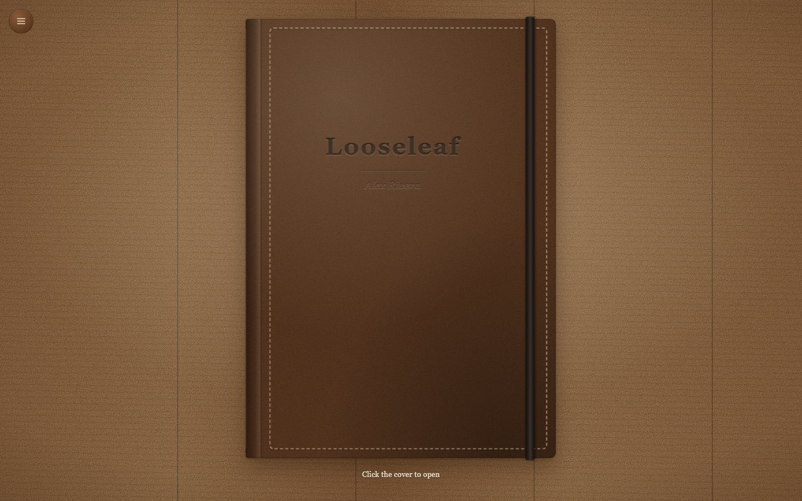
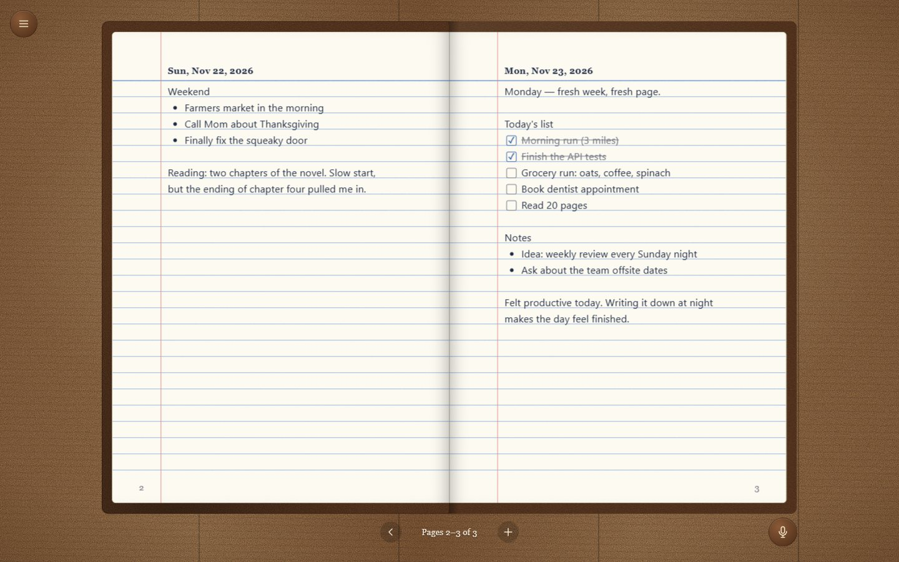
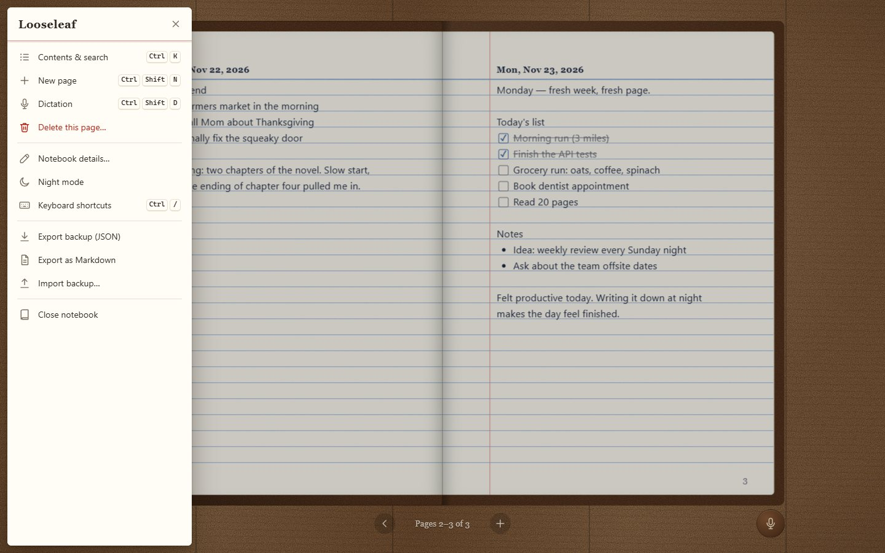
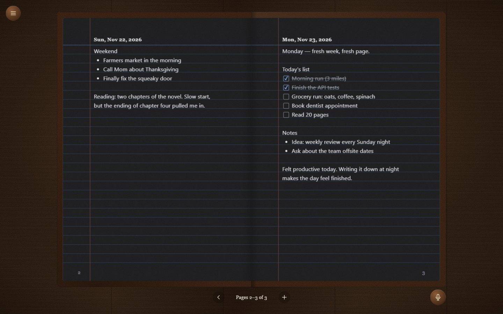
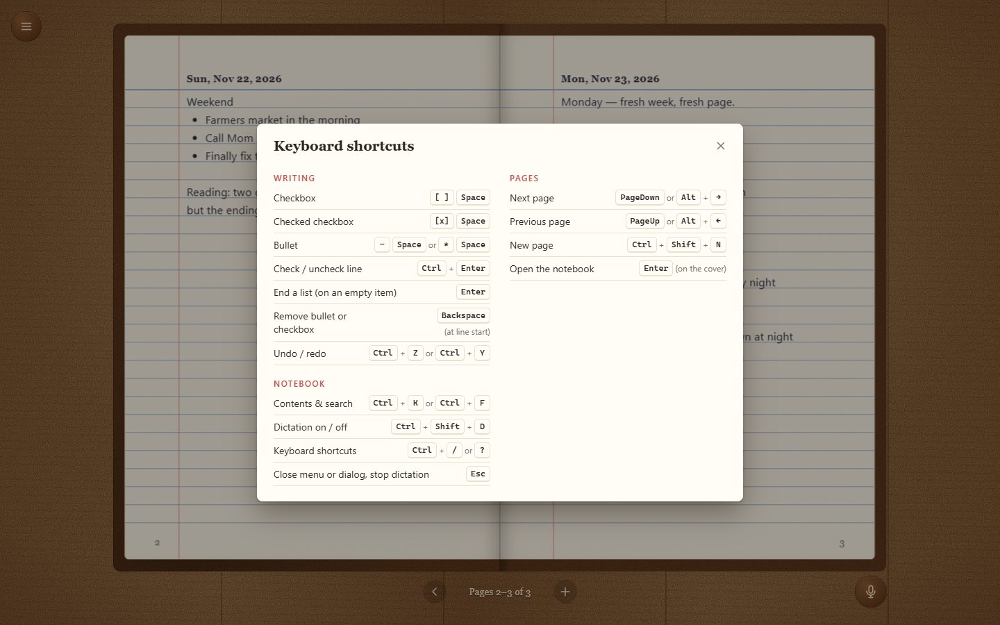

# Looseleaf

A private journal that looks and feels like a **leather-bound notebook full of college-ruled paper**. Open the cover and write, check off to-dos, turn pages, and keep adding sheets.
It runs entirely on your own computer, with **zero dependencies**: just Node.js and a browser.

<table>
  <tr>
    <td></td>
    <td></td>
  </tr>
  <tr>
    <td></td>
    <td></td>
  </tr>
</table>

## Keyboard shortcuts

Press <kbd>Ctrl</kbd>+<kbd>/</kbd> (or <kbd>?</kbd>) in the app to see these on a card.

| Writing | |
| --- | --- |
| Checkbox | type `[ ]` then <kbd>Space</kbd> (`[x]` for checked) |
| Bullet | type `-` or `*` then <kbd>Space</kbd> |
| Check / uncheck the current line | <kbd>Ctrl</kbd>+<kbd>Enter</kbd> |
| End a list | <kbd>Enter</kbd> on an empty item |
| Remove a bullet or checkbox | <kbd>Backspace</kbd> at the start of the line |
| Undo / redo | <kbd>Ctrl</kbd>+<kbd>Z</kbd> / <kbd>Ctrl</kbd>+<kbd>Y</kbd> |

| Pages | |
| --- | --- |
| Next / previous page | <kbd>PageDown</kbd> / <kbd>PageUp</kbd>, or <kbd>Alt</kbd>+<kbd>→</kbd> / <kbd>Alt</kbd>+<kbd>←</kbd> |
| New page | <kbd>Ctrl</kbd>+<kbd>Shift</kbd>+<kbd>N</kbd> |
| Open the notebook | <kbd>Enter</kbd> on the cover |

| Notebook | |
| --- | --- |
| Contents & search | <kbd>Ctrl</kbd>+<kbd>K</kbd> or <kbd>Ctrl</kbd>+<kbd>F</kbd> |
| Dictation on / off | <kbd>Ctrl</kbd>+<kbd>Shift</kbd>+<kbd>D</kbd> |
| Keyboard shortcuts | <kbd>Ctrl</kbd>+<kbd>/</kbd> or <kbd>?</kbd> |
| Close a menu or dialog, stop dictation | <kbd>Esc</kbd> |



## Features

- **A notebook, not a web page.**
  - A leather cover with a debossed title, stitching, and an elastic band swings open onto a two-page spread.
  - The notebook rests on a wooden desk.
  - Turning a page animates the sheet across the spread. You can also click a page's dog-eared corner.
- **College-ruled paper.**
  - 9/32" line spacing, and a red margin.
  - Text, including wrapped lines, always sits exactly on the rules.
  - The book scales to fit any window, snapped so the rules stay crisp, and switches to single-page mode in narrow windows.
- **Pages that fill up.** Each A5 sheet holds 24 lines. Type past the bottom and the overflow, even mid-paragraph at a word boundary, moves to the next page. The book turns and your cursor follows.
- **Checklists and bullets.** Type `[ ] ` or `- `, then click a box to check it off.
- **Dictation.** Click the mic button (or press <kbd>Ctrl</kbd>+<kbd>Shift</kbd>+<kbd>D</kbd>) and speak. A live caption shows what's being heard, and saying "new line" starts a new line.
- **Contents & search.** A contents page lists every entry with dotted leaders to its page number. Search filters it live and highlights matches on the page, using the CSS Custom Highlight API so the editable text is never touched.
- **Everything else lives in one menu:** new page, delete page (always asks first), notebook title and owner, night mode, export, import, and close.
- **Autosave** within about 400 ms of each change. There's no save button.
- **Backups you control.**
  - Export to JSON (a full backup) or Markdown (readable).
  - Import with *merge* or *replace*.
  - Automatic daily backups, keeping the last 30.
- **Night mode.** A dark walnut desk and dimmed paper. It follows your OS setting, with a manual toggle.

## Quick start

Requires [Node.js](https://nodejs.org) 20+.

```bash
git clone https://github.com/jnewera/looseleaf.git
cd looseleaf
npm start            # → http://127.0.0.1:4317
```

**On Windows**, double-click `Looseleaf.vbs`. It starts the server in the background (only if it isn't already running) and opens Looseleaf in its own Edge app window. For one-click access, right-click it and choose *Send to → Desktop (create shortcut)*.

Your entries are stored in `data/journal.json`, with daily backups in `data/backups/`. The `data/` folder is gitignored and never leaves your machine.

> **About dictation:** it uses the browser's built-in speech recognition (Web Speech API). Edge, Chrome, and Safari send the audio to their speech service (Microsoft, Google, or Apple) to transcribe it. Your journal itself stays local. Where the API isn't available (Firefox), the mic button is hidden.

## Architecture

```
public/                Vanilla JS front end (ES modules, no build step)
  js/app.js            State, autosave, page operations, import/export, wiring
  js/book.js           Views/spreads, page-turn and cover animations, fit-to-window
  js/editor.js         PageEditor: contenteditable page, line types, overflow, undo
  js/menu.js           Menu panel, contents/search, dialogs
  js/shortcuts.js      Shortcut table → shortcuts card, menu hints, tooltips
  js/dictation.js      Web Speech API wrapper and "new line" commands
  js/api.js            The only module that talks to storage (swap point for sync)
  css/base.css         Design tokens, day/night themes, desk
  css/book.css         Cover, paper, ruling, page turn
  css/ui.css           Menu, dialogs, mic, status
  img/icons.svg        SVG icon sprite
server/
  store.js             JSON storage: validation, atomic writes, backups, LWW merge
  server.js            node:http server: static files and a small REST API
test/                  node:test suites for storage and HTTP
```

**Design notes**

- **Ruled lines are pure CSS.** A `repeating-linear-gradient` draws the rules. The editor's `line-height` equals the rule spacing (27px), so every row lands on a rule. Editors are the same width on left and right pages, so wrapping, and therefore page overflow, never changes when a page moves.
- **Scaling without breaking measurement.** The book is scaled with a CSS `transform`, which doesn't affect layout values like `scrollHeight`. Overflow math stays exact at any window size.
- **Only visible pages get editors.** Overflow onto a page that isn't showing is measured in an off-screen container, and the cascade continues from there.
- **The editor keeps a flat DOM.** Each line is one `<div class="ln" data-type>` holding plain text, so the DOM maps 1:1 to the data model. Browser quirks are normalized after every input, and undo/redo is snapshot-based.
- **Animations never block work.** Page turns are queued, and each one has a timeout fallback, so a paused animation (for example in a hidden window) can't freeze navigation.
- **Safe storage.** Writes go to a temp file that's then renamed over the real one, and are serialized through a promise queue.
- **Security, even though it's local:**
  - The server binds to `127.0.0.1` only.
  - It rejects non-localhost `Host` headers (blocking DNS rebinding).
  - Writes must be `application/json`, which forces a CORS preflight that other sites can't pass.
  - All input is validated, and a strict CSP is sent.

### API

| Method | Path | Description |
| --- | --- | --- |
| `GET` | `/api/notebook` | Notebook details plus all pages, including deletion tombstones |
| `PUT` | `/api/pages/:id` | Create or update a page (last write wins on `updatedAt`) |
| `DELETE` | `/api/pages/:id` | Soft-delete a page |
| `PUT` | `/api/meta` | Update the notebook's title and owner |
| `POST` | `/api/import` | `{ mode: "merge" \| "replace", notebook }` |

## Testing

```bash
npm test
```

Covers persistence, atomic writes, last-write-wins, tombstones, backup rotation, import modes, notebook details, input validation, the Host and content-type guards, and path traversal. CI runs the suite on Ubuntu and Windows.

## Roadmap

The data model is already built for sync:
- Every page has a UUID, an `updatedAt` time, and a fractional `order`.
- Deletions are kept as tombstones.
- All storage access goes through `public/js/api.js`.

Planned next steps:

- [ ] Offline-first client cache (IndexedDB) behind the same `api.js` interface
- [ ] Installable PWA for phones
- [ ] Sync between devices (per-page last-write-wins, then smarter merging)
- [ ] Optional handwriting-style font
- [ ] Optional PIN lock

## License

[MIT](LICENSE)
