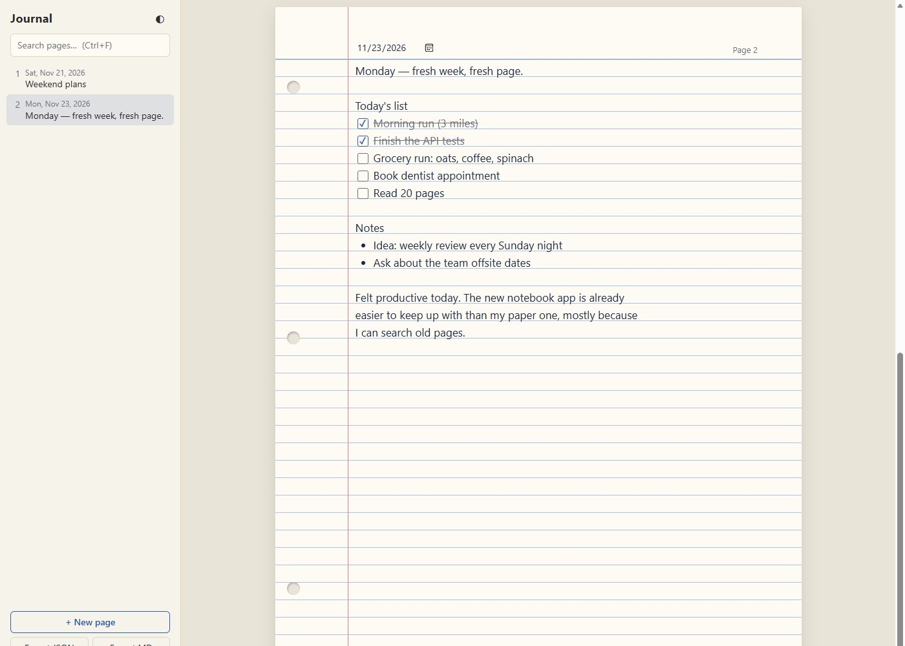
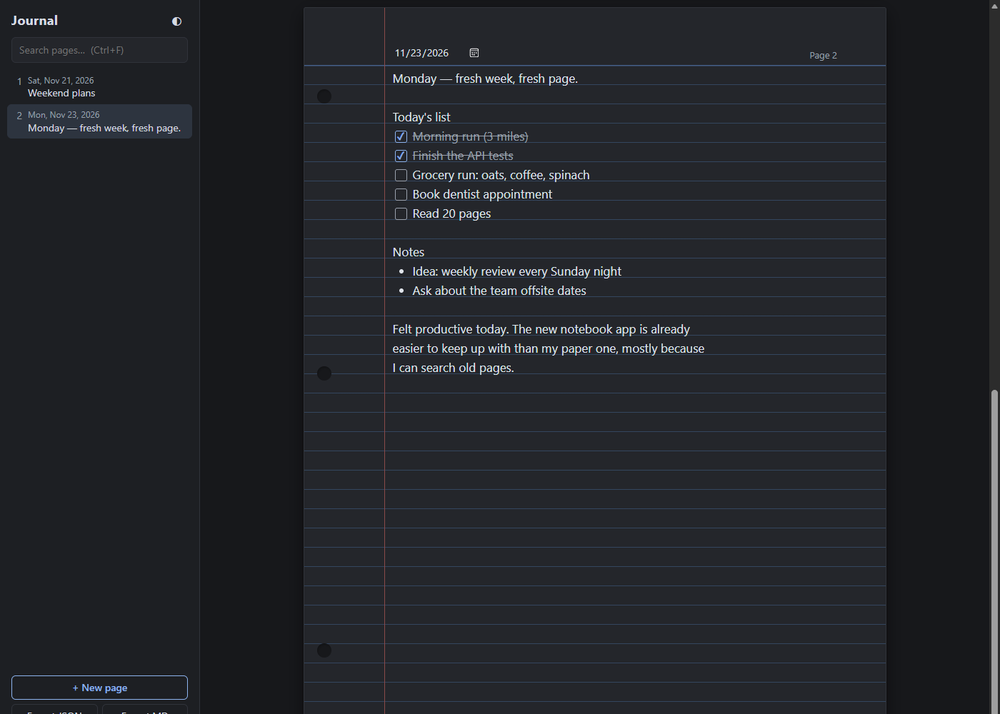

# Looseleaf

A fast, private journal that looks and feels like a **college-ruled paper notebook**, with checklists you can tick off and pages you can keep adding.
It runs entirely on your own computer. There are **zero dependencies**: just Node.js and a browser.



<details>
<summary>Dark mode</summary>


</details>

## Features

- **Real notebook feel.** College-ruled lines (9/32" spacing), a red margin, and hole punches. Text, including wrapped lines, always sits exactly on the rules.
- **Pages that fill up.** Each page holds 33 lines. Type past the bottom and the overflow, even mid-paragraph at a word boundary, moves to a new page, and your cursor follows it.
- **Checklists and bullets.** Type `[] ` for a checkbox or `- ` for a bullet. Click a box to check it off. `Ctrl+Enter` toggles the current line.
- **Autosave.** Every change is saved within about 400 ms, and saving is forced when the window closes. There's no save button.
- **Search and page index.** Search filters pages live and highlights matches in place (using the CSS Custom Highlight API, so the editable text isn't touched).
- **Backups you control.**
  - Export to JSON (a full backup) or Markdown (readable).
  - Import a backup with *merge* or *replace*.
  - Automatic daily backups, keeping the last 30.
- **Dark mode.** Follows your OS setting, with a manual toggle.
- **Undo/redo**, multi-line paste that understands Markdown lists, and keyboard shortcuts.

## Quick start

Requires [Node.js](https://nodejs.org) 20+.

```bash
git clone https://github.com/jnewera/looseleaf.git
cd looseleaf
npm start            # → http://127.0.0.1:4317
```

**On Windows**, double-click `Looseleaf.vbs`. It starts the server in the background (only if it isn't already running) and opens the journal in its own Edge app window. For one-click access, right-click it and choose *Send to → Desktop (create shortcut)*.

Your entries are stored in `data/journal.json`, with daily backups in `data/backups/`. The `data/` folder is gitignored and never leaves your machine.

| Shortcut | Action |
| --- | --- |
| `[] ` / `[x] ` | Start a checkbox (unchecked / checked) |
| `- ` or `* ` | Start a bullet |
| `Enter` on an empty bullet/checkbox | End the list |
| `Ctrl+Enter` | Toggle the checkbox on the current line |
| `Ctrl+Z` / `Ctrl+Y` | Undo / redo |
| `Ctrl+F` | Search |
| `Ctrl+Shift+N` | New page |

## Architecture

```
public/              Vanilla JS front end (ES modules, no build step)
  js/editor.js       PageEditor: contenteditable page, line types, overflow, undo
  js/app.js          Pages, autosave, index, search, import/export, theme
  js/api.js          The only module that talks to storage (swap point for sync)
  css/notebook.css   Paper, ruling, and light/dark themes
server/
  store.js           JSON storage: validation, atomic writes, backups, LWW merge
  server.js          node:http server: static files and a small REST API
test/                node:test suites for storage and HTTP
```

**Design notes**

- **Ruled lines are pure CSS.** A `repeating-linear-gradient` draws the rules. The editor's `line-height` equals the rule spacing (27px), so every rendered row, wrapped or not, lands on a rule. Pages are a fixed width so that line wrapping, and therefore page overflow, is deterministic.
- **The editor keeps a flat DOM.** Each line is one `<div class="ln" data-type>` holding plain text, so the DOM maps 1:1 to the data model. Browser quirks (injected spans, stray text nodes) are normalized after every input. Rich-text formatting is blocked.
- **Overflow:** when content is taller than the page, trailing blocks move to the next page. If a paragraph straddles the bottom edge, a binary search finds the longest prefix that fits and splits it at a word boundary.
- **Safe storage.** Writes go to a temp file that is then renamed over the real one, so a crash can't corrupt the journal. Writes are serialized through a promise queue.
- **Security, even though it's local:**
  - The server binds to `127.0.0.1` only.
  - It rejects non-localhost `Host` headers (blocking DNS rebinding).
  - Writes must be `application/json`, which forces a CORS preflight that other sites can't pass.
  - All input is validated, and a strict CSP is sent.

### API

| Method | Path | Description |
| --- | --- | --- |
| `GET` | `/api/notebook` | All pages, including deletion tombstones |
| `PUT` | `/api/pages/:id` | Create or update a page (last write wins on `updatedAt`) |
| `DELETE` | `/api/pages/:id` | Soft-delete a page |
| `POST` | `/api/import` | `{ mode: "merge" \| "replace", notebook }` |

## Testing

```bash
npm test
```

Covers persistence, atomic writes, last-write-wins, tombstones, backup rotation, import modes, input validation, the Host and content-type guards, and path traversal. CI runs the suite on Ubuntu and Windows.

## Roadmap

The data model is already built for sync:
- Every page has a UUID, an `updatedAt` time, and a fractional `order`.
- Deletions are kept as tombstones.
- All storage access goes through `public/js/api.js`.

Planned next steps:

- [ ] Offline-first client cache (IndexedDB) behind the same `api.js` interface
- [ ] Installable PWA for phones
- [ ] Sync between devices (per-page last-write-wins, then smarter merging)
- [ ] Optional handwriting-style font
- [ ] Optional PIN lock

## License

[MIT](LICENSE)
